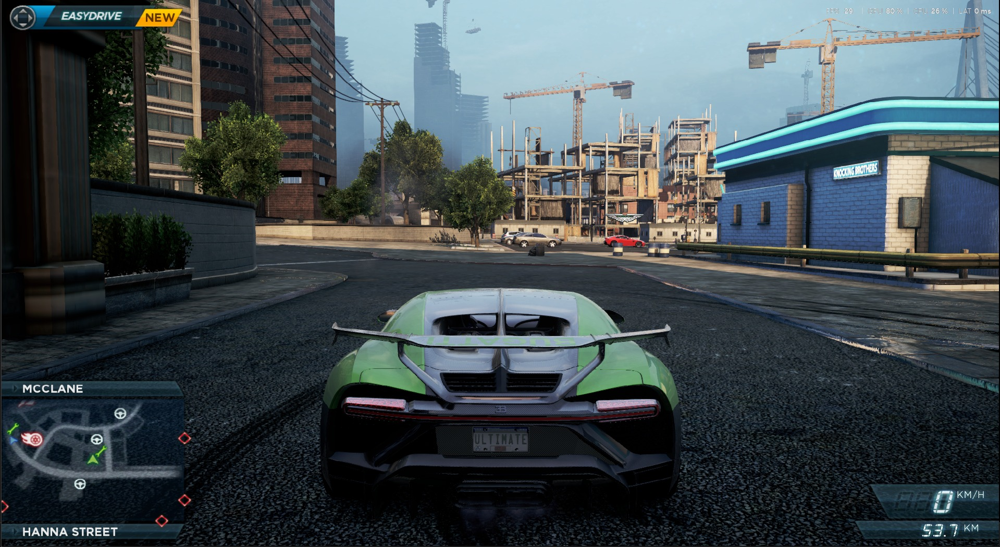

# NFSMW 2012 RTX — experimental

Ray tracing por hardware para **Need for Speed: Most Wanted (2012)**, usando um addon ReShade de 32 bits e um auxiliar DXR de 64 bits. Inclui reflexos, sombras/oclusão e iluminação complementar do sol, farol e luzes reconhecidas na cena.



*Captura de gameplay fornecida pelo autor. Exemplo visual de uma cena de teste; o FPS varia conforme a cena e as configurações.*

**[Baixar o pacote pronto](https://github.com/enzofrancez/nfsmw2012-rtx/releases)** · [Limitações](#limitações-e-desempenho) · [Como compilar](#compilar-o-código)

O pacote público corresponde à base **v19 / v0.19.0 preview**, com compactação de triângulos vazios e a composição atualizada. É um protótipo de DXR; não usa RTX Remix e não é um remaster completo do jogo.

## Requisitos

- Uma instalação própria do **Most Wanted 2012**, com `NFS13.exe` de 32 bits. Testado na versão **1.5.0.0**; outras versões não foram validadas. Não serve para Most Wanted 2005.
- Windows 10/11 de 64 bits e driver de vídeo com DXR 1.1 e compartilhamento D3D11/D3D12. Testado somente numa **GeForce RTX 4060**, em **1920 × 1080**.
- **ReShade 6.8.0 com full add-on support**. Essa é a versão validada; versões mais novas precisam manter compatibilidade com a API do addon.
- Uso **offline / single-player**. Não use em partidas online ou clientes protegidos por anti-cheat.

Não é necessário compilar para instalar a versão pronta. ReShade é a única instalação externa descrita abaixo; o ZIP já traz os binários do mod e seus shaders.

## Instalação rápida

1. Feche o jogo. Acesse **[ReShade oficial](https://reshade.me/#download)** e baixe a opção **“with full add-on support”**. Execute o instalador, selecione `NFS13.exe` e a API **DirectX 10/11/12**. Quem já usa essa versão completa pode pular esta etapa. O mod não inclui nem substitui a DLL do ReShade.
2. Em **[Releases](https://github.com/enzofrancez/nfsmw2012-rtx/releases)**, baixe **`NFSMW2012-RTX-v0.19.0.zip`** e extraia tudo para uma pasta. Use esse arquivo, não os links automáticos **Source code**: eles contêm o projeto sem os binários prontos.
3. Dê dois cliques em **`Instalar.cmd`**. Escolha se deseja as ferramentas opcionais de horário/freecam e selecione o **`NFS13.exe`** do jogo.
4. Aguarde a mensagem de instalação concluída. O instalador verifica os hashes, faz backup dos arquivos anteriores e seleciona o preset do mod. **Não apague a pasta `.nfsmw-rtx` criada no jogo**: ela guarda o backup.
5. Abra o jogo offline e entre na rua. Na primeira abertura, aguarde a compilação dos shaders. O RTX é habilitado pelo comando instalado e só aparece quando houver câmera, profundidade e geometria disponíveis.

O instalador não modifica o executável, os arquivos de conteúdo ou os saves. Ele adiciona arquivos do mod e ajusta `ReShade.ini`, com cópia anterior no backup. O `.cmd` chama PowerShell com política de execução restrita ao processo; não altera a política permanente do Windows.

Se o ReShade já usa um `AddonPath` personalizado, o instalador interrompe antes de alterar os arquivos. Ele espera addons na pasta do jogo (`AddonPath=.\`). Não substitua configurações de outros mods sem conferir a compatibilidade.

### Instalação por PowerShell

Com o jogo fechado, na pasta extraída:

```powershell
.\Install.ps1 -GamePath 'D:\Jogos\Most Wanted 2012'
# Para incluir horário e câmera livre:
.\Install.ps1 -GamePath 'D:\Jogos\Most Wanted 2012' -SceneTools
```

## Como usar

| Controle | Função |
| --- | --- |
| **Home** | Abre/fecha o painel ReShade. |
| **F7** | Marca/desmarca a técnica **NFSMW RTX**. |
| **Controle-RTX.cmd** | Envia ativar/desativar ao addon ou mostra as últimas linhas do log. |

No painel **Home**, selecione o preset `NFSMW2012-RTX.ini` e mantenha a técnica **NFSMW RTX v19** marcada. Os sliders permitem ajustar **Sombras e AO RTX**, **Reflexos DXR**, **Rebote DXR**, **Luzes locais RTX** e **Estabilidade espacial dos reflexos**. O preset usa os valores testados; comece por eles.

Existem dois controles: o estado da técnica no ReShade e a habilitação do addon. Para ver os efeitos, ambos devem estar ligados. O instalador habilita o addon automaticamente. `Controle-RTX.cmd` pode habilitá-lo novamente sem redefinir os sliders.

### Confirmar que o RTX realmente está funcionando

1. Compare a mesma cena com **F7** ligado/desligado, sem mover a câmera.
2. Observe sombras/reflexos e a diferença de aplicação perto do minimapa. Essa faixa é uma máscara intencional para proteger o HUD; ela foi mantida como referência visual.
3. Se necessário, use `Controle-RTX.cmd` → mostrar log. No arquivo **`NFSMW_RTX.log`**, procure trabalhos recentes **`Current-frame DXR`** seguidos por **`Completed GPU job`**. `compact=1` informa uso da compactação de geometria válida.

**Apenas marcar a técnica, ver “GPU RTX enabled” ou atingir 60 FPS não prova que os raios estão sendo executados.** Se aparecer `GPU bridge failed` / `DXR timeout`, a proteção desliga os efeitos; o FPS pode subir justamente porque o RTX parou. Reinicie o jogo antes de tentar reativar. Não aumente o tempo limite para ocultar falhas.

### Horário e freecam — opcionais

Esses controles exigem instalar `NFSMW_SceneTools.addon32` pela opção do instalador. Foram testados no executável 1.5.0.0 e validam os pontos de integração antes de ativar os hooks.

- **Home → Ferramentas da cena**: ajuste o horário, use **Meio-dia** / **Noite**, congele o horário ou retome **Ciclo normal**.
- **F6**: entra/sai da câmera livre e devolve a câmera ao carro.
- **W/A/S/D**: deslocamento; **Q/E**: descer/subir; **setas**: girar.
- **Shift**: acelera; **Ctrl**: movimento preciso. Feche o painel com Home para usar os controles.
- A simulação não fica pausada. **O controle pelo mouse tem um problema conhecido**; use as setas. A interface ainda oferece a opção de mouse, mas ela não é uma função validada nesta versão.

## Limitações e desempenho

- **Sem promessa de 60 FPS.** Na RTX 4060 testada, a v19 ficou por volta de **40–50 FPS** em trechos relatados, com cenas mais pesadas perto de 30 e cenas leves chegando a 60. Isso não é um benchmark reproduzível nem garantia para outro computador.
- A resolução validada é **1080p**. Os mapas DXR têm tamanho fixo; outras resoluções/proporções e layouts de HUD não foram validados.
- Pode haver piscada residual, radiância incompleta, artefatos em detalhes finos e custo elevado de captura da geometria.
- A cor dos objetos refletidos depende da imagem disponível. Partes ocultas, inclusive regiões inferiores do carro, podem não ter cor utilizável; não existe reconstrução completa do cenário fora da câmera.
- Máscaras fixas protegem o HUD e também deixam uma área próxima dele sem os efeitos adicionais.
- O sol/farol e somente as luzes reconhecidas são usados. Não há cobertura universal de todos os materiais emissivos ou da iluminação gravada em texturas.
- Os ajustes de roughness/especular são experimentais; alguns materiais podem parecer refletivos demais ou de menos.
- As experiências de refit da v18/v18.1 **não estão nesta versão**: apresentaram falhas no jogo e foram abandonadas. A v19 reconstrói a estrutura após compactar dados vazios, preservando os triângulos válidos.
- Não foram validadas combinações com DXVK, outros wrappers, injectors ou modpacks gráficos. Instale em uma configuração conhecida e mantenha o backup.

## Problemas comuns

| Sintoma | O que conferir |
| --- | --- |
| O jogo não mostra a aba Add-ons / addon não carrega | Confirme o ReShade **full add-on support**, de 32 bits para este executável, e os arquivos na mesma pasta de `NFS13.exe`. |
| F7 muda o checkbox, mas a imagem não muda | Entre na rua; confira addon habilitado e trabalhos concluídos no log. Falha da proteção requer reiniciar. |
| Shader não compila | Leia `ReShade.log`; mantenha `NFSMW_RTX.fx` e `NFSMW_ReShade.fxh` juntos em `reshade-shaders/Shaders`. |
| Recorte perto do minimapa | É a máscara intencional do HUD nesta versão. |
| FPS caiu | Compare parado, com a mesma câmera, usando F7. Não compare cenas diferentes. O addon faz trabalho adicional real na GPU. |
| Instalador diz que os arquivos estão bloqueados | Feche o jogo; não tente substituir o addon carregado. |
| Erro de hash | Extraia novamente o ZIP da release. Não misture addon, auxiliar e `.cso` de versões diferentes. |

Para abrir um issue, informe versão do jogo/Windows/ReShade, GPU, resolução, FPS com/sem RTX na mesma cena e as linhas relevantes dos logs. **Revise os logs e remova caminhos pessoais antes de publicá-los.** Não envie executáveis, arquivos do jogo ou capturas brutas de geometria.

## Desinstalar / restaurar

1. Feche o jogo.
2. Na pasta do pacote extraído, execute **`Desinstalar.cmd`**.
3. O script restaura o estado anterior à instalação mais recente e remove apenas os arquivos que ela adicionou. Preserva o backup e não desinstala o runtime ReShade.

Também é possível escolher um backup específico:

```powershell
.\Uninstall.ps1 -GamePath 'D:\Jogos\Most Wanted 2012' `
  -Backup 'D:\Jogos\Most Wanted 2012\.nfsmw-rtx\backups\PASTA-DO-BACKUP'
```

Restaurar o backup devolve também o `ReShade.ini` anterior; alterações posteriores nas configurações do ReShade podem ser substituídas. Se você atualizou sobre uma versão já instalada, o estado anterior pode ser essa versão mais antiga do mod.

## Compilar o código

Para desenvolvimento: Visual Studio 2022 Build Tools com **Desktop development with C++**, ferramentas x86/x64 e Windows SDK com **DXC**. O script descobre os caminhos; não contém caminhos de usuário fixos.

```powershell
.\scripts\Build.ps1
.\tests\Installer.Tests.ps1
.\scripts\Package.ps1
```

Os binários ficam em `dist/payload` e o ZIP em `artifacts`. O CI do GitHub compila e testa o instalador em Windows; ele não valida gráficos ou FPS no jogo. As ferramentas de cena são compiladas como addon x86, e o auxiliar DXR como executável x64.

## Organização

```text
src/rtx/           addon, protocolo GPU, auxiliar e HLSL DXR
src/scene-tools/   horário e câmera livre opcionais
shaders/           composição ReShade
presets/           preset limpo, sem dependências Lumenite/DLSS
scripts/           compilação, empacotamento e suporte do instalador
tests/             regressões de instalação/restauração em pasta simulada
third_party/       headers e licenças necessários para compilar
docs/images/       captura de gameplay autorizada para o README
```

Projeto desenvolvido com assistência de IA, testado e iterado no jogo. Código próprio sob **MIT**; veja [créditos e licenças](THIRD_PARTY_NOTICES.md). Não inclui arquivos proprietários do jogo, saves, dumps, capturas de geometria ou o runtime ReShade. Projeto não oficial, sem afiliação com Electronic Arts ou NVIDIA.
